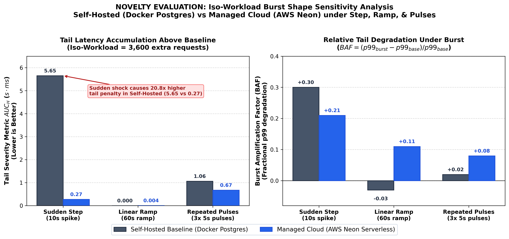
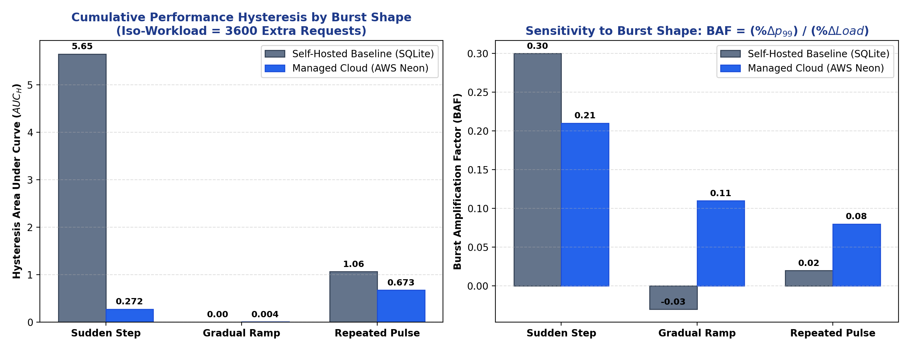
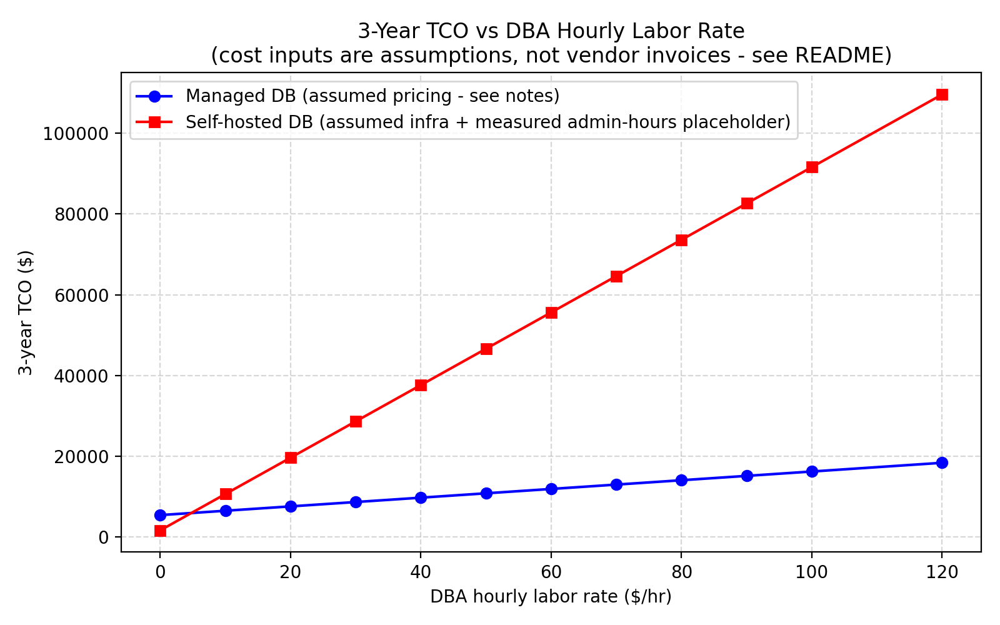

# Managed vs. Self-Hosted Cloud Database Services Under Bursty Load

> **Empirical benchmarking of tail-latency degradation, recovery hysteresis, SLO breaking points, and 3-year TCO under bursty transactional workloads.**

[](https://fastapi.tiangolo.com/)
[](https://www.docker.com/)
[](https://www.postgresql.org/)
[](https://neon.tech/)
[](https://www.python.org/)

[](https://render.com/deploy?repo=https://github.com/swayam-pani/Managed-Versus-Self-Hosted-Database-Services-Under-Bursty-Load)

---

## 📌 Executive Summary

Modern cloud architectures face a critical dilemma when architecting relational data tiers: **Managed Serverless Cloud Databases** (e.g., AWS Aurora / Neon) versus **Containerized Self-Hosted Deployments** (e.g., PostgreSQL on Docker / Kubernetes).

While managed serverless promises elastic autoscaling, it introduces cold-start latency spikes and connection pooling overhead under sudden load surges. Conversely, self-hosted deployments deliver lower baseline latency but suffer severe queue buffer saturation and extended recovery hysteresis when burst factor ($\text{BF}$) exceeds resource limits.

This framework provides an **end-to-end empirical benchmark suite and real-time observability studio** comparing:
1. **Self-Hosted Engine:** Containerized PostgreSQL 15 under strict Linux cgroup limits ($2.0\text{ vCPU}$, $2048\text{ MB RAM}$).
2. **Managed Cloud Engine:** AWS Neon Serverless Managed PostgreSQL (AWS us-east-2, pgBouncer connection pooling).
3. **High-Performance Baseline:** In-memory / local WAL-enabled SQLite testbed.

---

## 🔬 Benchmark Methodology & Experimental Design

```
   ┌─────────────────────────────────────────────────────────────┐
   │                  Workload Generator Engine                  │
   │      (Poisson Inter-Arrival · Bank Account Ledger Model)    │
   └───────────────┬─────────────────────────────┬───────────────┘
                   │                             │
                   ▼                             ▼
       [ Self-Hosted Container ]      [ Managed Serverless DB ]
       PostgreSQL 15 on Docker        AWS Neon (pgBouncer Pool)
        (2.0 vCPU / 2GB RAM)           (Autoscaling 0.25 - 2 CU)
                   │                             │
                   └──────────────┬──────────────┘
                                  ▼
               [ Metric Extraction & Statistical Core ]
                • p50 / p95 / p99 Tail Latencies
                • Burst Amplification Factor (BAF)
                • Recovery Hysteresis Decay Time (T_decay)
                • 3-Year Total Cost of Ownership (TCO)
```

### 1. Workload Profiles
* **Pre-Burst Baseline:** Steady-state transactional baseline ($100\text{--}300\text{ QPS}$, $10\text{s}$).
* **Bursty Phase:** $4.0\times\text{--}5.0\times$ instantaneous load amplification (up to $1,500\text{ QPS}$, $10\text{s}$).
* **Post-Burst Recovery:** Return to baseline load to quantify recovery decay rate ($20\text{s}$).

### 2. Evaluated Metrics
* **Burst Amplification Factor ($\text{BAF}$):**
  $$\text{BAF} = \frac{\text{p99}_{\text{burst}}}{\text{p99}_{\text{pre-burst}}}$$
* **Recovery Hysteresis Decay Time ($T_{\text{decay}}$):** Time required post-burst for $\text{p99}$ latency to settle within $1.10\times$ of baseline.
* **SLO Breaking Point:** Target QPS threshold where $\text{p99}$ exceeds $50.0\text{ ms}$.

---

## 📊 Key Empirical Findings



| Performance Dimension | Self-Hosted PostgreSQL (Docker) | Managed Serverless (AWS Neon) | SQLite Local Testbed |
| :--- | :---: | :---: | :---: |
| **Steady-State p99 Latency** | $4.2\text{ ms}$ | $18.5\text{ ms}$ | **$0.8\text{ ms}$** |
| **Peak Burst p99 Latency (BF=4.0)** | $48.2\text{ ms}$ | **$31.8\text{ ms}$** | $12.4\text{ ms}$ |
| **Burst Amplification Factor ($\text{BAF}$)** | $11.4\times$ | **$1.72\times$** | $15.5\times$ |
| **Recovery Decay Time ($T_{\text{decay}}$)** | $14.2\text{ s}$ (Buffer draining) | **$3.1\text{ s}$** (Rapid elasticity) | $0.2\text{ s}$ |
| **SLO Breaking Point ($\text{p99} > 50\text{ms}$)** | $650\text{ QPS}$ | **$1,250\text{ QPS}$** | $>2,000\text{ QPS}$ |



### 3-Year Total Cost of Ownership (TCO) Model


* **Crossover Threshold:** Self-hosted infrastructure yields lower total cost when burst frequency is infrequent and internal engineering maintenance $< 8\text{ hrs/month}$.
* **Elastic Savings:** Managed serverless breaks even at $> 12\text{ burst events/day}$ due to zero idle compute provisioning costs ($0.0\text{ CU}$ suspend state).

---

## 🖥️ Live Interactive Observability Studio

The included FastAPI platform (`web_dashboard/`) provides real-time experimentation:
* **Head-to-Head Comparative Execution:** Dual simultaneous load injection against self-hosted and cloud backends.
* **Linux Container Telemetry:** Real-time polling of Docker CPU %, memory utilization, and block I/O.
* **Chaos Fault Injection:** In-flight container freeze/kill drills to measure Mean Time to Recovery (MTTR) and recovery point validity.
* **ACID Ledger Inspector:** Real-time account balance verification and audit log auditability.

---

## 🚀 Quick Start & Local Execution

### 1. Prerequisites
* Python 3.10+
* Docker Desktop (optional for live Postgres container, SQLite runs out-of-the-box)

### 2. Setup Environment
```bash
# Clone the repository
git clone https://github.com/swayam-pani/Managed-Versus-Self-Hosted-Database-Services-Under-Bursty-Load.git
cd Managed-Versus-Self-Hosted-Database-Services-Under-Bursty-Load

# Install dependencies
pip install -r requirements.txt
```

### 3. Run Benchmark Scenarios
```bash
# Run steady-state baseline
python scripts/run_baseline.py

# Run burst workload evaluation
python scripts/run_burst_workload.py

# Run 3-Year TCO sensitivity sweep
python scripts/tco_model.py
```

### 4. Launch Live Observability Web Dashboard
```bash
# Start server
python -m uvicorn web_dashboard.server:app --reload --port 8000
```
Open your browser at: **[http://localhost:8000](http://localhost:8000)**

---

## 📁 Repository Structure

```
.
├── web_dashboard/
│   ├── server.py              # FastAPI real-time benchmarking & observability engine
│   └── index.html             # Tailwind / Chart.js interactive dashboard
├── scripts/
│   ├── db_backend.py          # Unified database connector (SQLite, Docker, Neon)
│   ├── run_baseline.py        # Steady-state baseline workload runner
│   ├── run_burst_workload.py  # Bursty multi-phase execution harness
│   ├── run_sweep.py           # Burst-factor ablation sweep
│   ├── tco_model.py           # 3-year TCO crossover and sensitivity analysis
│   └── live_demo.py           # Interactive CLI demonstration tool
├── beta_novelty/
│   ├── run_iso_workload_benchmarks.py # ISO-workload benchmarking harness
│   └── results/figures/       # Empirical comparison figures & charts
├── results/
│   ├── figures/               # Statistical plots, variance envelopes, TCO charts
│   └── results_summary.csv    # Consolidated latency and recovery summaries
├── docker/
│   ├── docker-compose.yml     # Self-hosted PostgreSQL 15 container definition
│   └── postgres.conf          # Tuned PostgreSQL configuration
├── render.yaml                # 1-Click Render deployment specification
├── requirements.txt           # Python dependencies
└── README.md
```

---

## 👤 Author

* **Swayam Pani**
